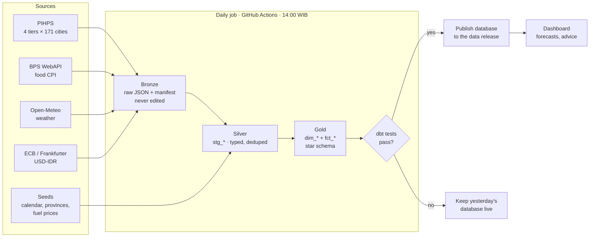

# PanganWatch

**PanganWatch tells a food buyer which prices are about to spike, where, and whether to buy now or wait — and shows how much that would have saved.**

> Status: Phase 1 (data platform) in progress. Headline numbers appear here once Gate 4 passes.

<!-- owner: data-engineer -->
## How the data pipeline works

Every weekday PanganWatch collects prices for 21 strategic commodities from Bank Indonesia's **PIHPS** in all four market tiers (producer, wholesale, traditional market, modern retail) for 171 cities in 34 provinces, plus monthly inflation (BPS), daily weather and the USD/IDR rate. History starts in 2022.



- **Bronze** keeps every response exactly as received, so a parsing bug is fixed by re-processing, never re-scraping.
- **Idempotent:** every fetch is recorded in a manifest; re-runs skip what's done, and the last 7 days are re-fetched because PIHPS revises them.
- **Polite:** 2 s between requests, a descriptive User-Agent, retries only on timeouts, 5xx and rate limits.
- **Gated:** `dbt build` runs models and 52 data tests together (uniqueness, units, price bounds, daily jumps, freshness in working days, coverage, farm ≤ wholesale ≤ retail). An error-level failure stops the run before anything is published.
- **Storage without a server:** between runs, raw archives and the database live as assets of a GitHub Release; raw data is saved even when a run fails.
- **Observable:** every run and test result is logged to `fct_pipeline_runs` / `fct_test_results` for the Data Quality page.

### Why GitHub Actions and DuckDB instead of Airflow and BigQuery

The whole dataset fits in one DuckDB file (well under 1 GB), and the job runs once a day for under an hour, so a hosted scheduler or warehouse would add cost and setup without adding capability. The same DAG maps one-to-one onto an orchestrator if the project grows:

| Step | Here | Airflow | Dagster |
|---|---|---|---|
| Ingest | `python -m ingestion.run_daily`, `bps`, `weather`, `fx` | 4 `PythonOperator`s in parallel | 4 assets, one per source |
| Transform + test | `dbt build` | `DbtTaskGroup` (Cosmos) | `dbt_assets` |
| Forecast, score, advise | `ml.*`, `decision.policy` | downstream tasks | downstream assets |
| Publish | upload to the `data` release | final task, `trigger_rule=all_success` | asset check gates the publish |

### Run locally (Windows; on macOS/Linux use `.venv/bin/`)

```bash
python -m venv .venv && .venv\Scripts\pip install -e .[dev]
.venv\Scripts\python -m ingestion.backfill --year 2026 --tier traditional --city 34
.venv\Scripts\python -m ingestion.daily_pipeline --skip-ingest
.venv\Scripts\python -m pytest
```

The second line pulls one small real slice (Jakarta, 2026); the third builds and tests every table from it. BPS needs a free key in `.env` (see `.env.example`).

### Data sources and credits

- **PIHPS Nasional — Bank Indonesia**, https://www.bi.go.id/hargapangan. Data © Bank Indonesia; used for non-commercial research with attribution. Raw dumps are not redistributed.
- **Badan Pusat Statistik (BPS)**, consumer price indices via the BPS WebAPI, https://webapi.bps.go.id.
- **Weather data by [Open-Meteo.com](https://open-meteo.com/)** (CC BY 4.0), historical archive based on ERA5.
- **USD/IDR**: European Central Bank reference rates via the [Frankfurter](https://frankfurter.dev) API.
<!-- /owner: data-engineer -->
